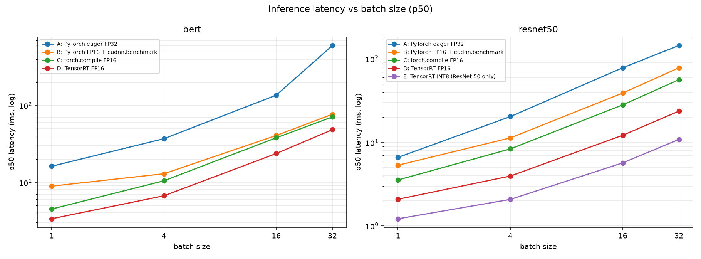
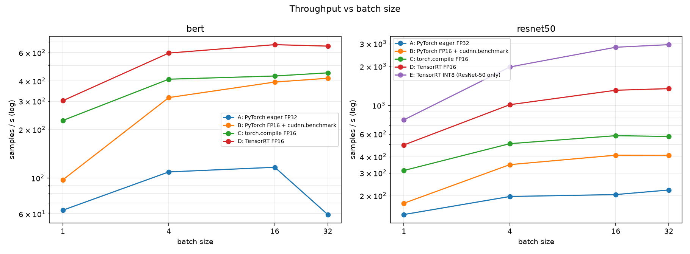

# AI inference optimization on an RTX 2050 (4 GB)

Benchmarks and profiles **ResNet-50** (torchvision, pretrained) and **BERT-base** (seq len 128) under increasing
levels of optimization.

| Config | What it is |
|---|---|
| A | PyTorch eager FP32 (baseline; see TF32 note in Methodology) |
| B | PyTorch FP16 (`.half()`) + `cudnn.benchmark=True` |
| C | `torch.compile` on the FP16 model (Inductor ran on this machine; falls back to TorchScript `trace`+`freeze` if compile fails) |
| D | ONNX export -> TensorRT FP16 engine (TensorRT Python API, dynamic batch profile 1/16/32) |
| E | TensorRT INT8 for ResNet-50 only (entropy calibration on 48 real photos in `data/images/`) |

## Layout

```
src/bench.py            benchmark harness (latency p50/p99, throughput, memory, accuracy) -> results/results.csv
src/backends.py         runners for A-E          src/trt_utils.py   ONNX export + TensorRT build + INT8 calibrator
src/models.py           models + deterministic inputs
src/profile_target.py   workload run under nsys/ncu    src/build_engines.py  pre-build engines
scripts/check_env.py    what is installed / what you must install
scripts/profile_nsys.sh Nsight Systems on ResNet-50 A, B, D at batch 16 -> results/nsys/ + profile_summary.md
scripts/profile_ncu.sh  Nsight Compute, one conv + one GEMM kernel at N=1
scripts/analyze_profile.py  nsys sqlite / ncu csv
scripts/make_plots.py   results/latency.png, results/throughput.png, speedup table, README injection
results/                results.csv, bench_log.txt, rerun_bert_A.csv (anomaly check), plots, nsys/, ncu/
```

## Run

```bash
bash scripts/run_all.sh                 
# or step by step
python -m src.bench 2>&1 | grep -v "\[TRT\]" | tee results/bench_log.txt   # full benchmark, ~15-30 min
python -m src.bench --models resnet50 --configs A B D --batch-sizes 1 16 --iters 100   # subset
python scripts/make_plots.py --update-readme    # plots + fills the blocks below
bash scripts/profile_nsys.sh            # -> results/nsys/*.nsys-rep
bash scripts/profile_ncu.sh             # (needs GPU performance-counter access)
```

First TensorRT builds take about a minute per engine here; engines are cached in `engines/` (`--rebuild` to redo).

### Methodology

* 20 warmup iterations, then 200 timed iterations (the final run). With 200 samples p99 is roughly the 2nd-worst sample;
  treat it as indicative, not a stable tail estimate.
* **Latency** = CUDA-event time of one inference after a full device sync (isolated-request latency).
  **Throughput** = separate back-to-back loop (queue full), `batch * iters / wall time`.
* All runs execute on a non-default CUDA stream (TensorRT warns and adds synchronisation otherwise).
* **Memory** = device-wide used-memory delta (`cudaMemGetInfo`) from before the runner is built until after the timed
  loops. It includes weights, activations, library workspaces and allocator cache, and excludes the CUDA context.
  **It is noisy**: e.g. ResNet-50 A shows 322 MB at batch 1 but 142 MB at batch 4, and INT8 shows 400 MB at batch 1 but
  94 MB at batch 4 (probably one-time library/workspace initialisation landing in the first measured row; not verified).
  Use it for rough orders of magnitude only. Everything fit in 4 GB; no OOM occurred.
* SM clock, temperature and power are sampled with `nvidia-smi` after each measurement and stored in the CSV.
* **Config A is partly TF32.** On Ampere, cuDNN convolutions use TF32 tensor cores by default; the Nsight kernel names for A
  contain `tf32f32`. So the ResNet-50 "FP32" baseline is not strict FP32, which makes the FP16/TensorRT speedups
  conservative compared with a strict-FP32 baseline. (Strict-FP32 ablation: not run.)
* TensorRT engines use one dynamic-batch profile (min 1 / opt 16 / max 32); tactics are tuned for batch 16.
* BERT: ONNX export uses eager attention; PyTorch configs use the default SDPA implementation. The classification head is
  randomly initialised (seeded), so BERT "accuracy" means equivalence with FP32, not task quality.
* Accuracy set: 64 samples. For ResNet-50 that is the 48 real images tiled to 64 (16 are duplicates), so one flipped
  prediction moves agreement by 1.6 points. INT8 was calibrated on the same 48 images.

## Results (this machine)

<!-- RESULTS:START -->
| model | config | batch | status | p50_ms | p99_ms | throughput_per_s | device_mem_delta_mb | max_abs_diff | top1_agree_pct |
|---|---|---|---|---|---|---|---|---|---|
| bert | A | 1 | ok | 16.195 | 17.783 | 63.1 | 542 | 0 | 100.0 |
| bert | A | 4 | ok | 37.011 | 38.435 | 109.1 | 470 | 0 | 100.0 |
| bert | A | 16 | ok | 136.518 | 140.855 | 116.6 | 540 | 0 | 100.0 |
| bert | A | 32 | ok | 604.087 | 609.740 | 59.3 | 656 | 0 | 100.0 |
| bert | B | 1 | ok | 8.924 | 17.383 | 97.4 | 254 | 0.001352 | 100.0 |
| bert | B | 4 | ok | 12.949 | 17.902 | 315.9 | 232 | 0.001352 | 100.0 |
| bert | B | 16 | ok | 40.805 | 42.388 | 394.4 | 252 | 0.001352 | 100.0 |
| bert | B | 32 | ok | 76.951 | 78.114 | 416.4 | 296 | 0.001352 | 100.0 |
| bert | C | 1 | ok | 4.491 | 9.386 | 227.7 | 242 | 0.0007929 | 100.0 |
| bert | C | 4 | ok | 10.483 | 11.289 | 410.8 | 212 | 0.0007929 | 100.0 |
| bert | C | 16 | ok | 38.058 | 38.903 | 430.1 | 242 | 0.0007929 | 100.0 |
| bert | C | 32 | ok | 71.110 | 73.109 | 449.9 | 276 | 0.0007929 | 100.0 |
| bert | D | 1 | ok | 3.358 | 3.852 | 302.1 | 262 | 0.00253 | 100.0 |
| bert | D | 4 | ok | 6.687 | 6.909 | 597.0 | 262 | 0.00253 | 100.0 |
| bert | D | 16 | ok | 23.747 | 24.319 | 673.3 | 262 | 0.00253 | 100.0 |
| bert | D | 32 | ok | 48.525 | 48.996 | 659.4 | 262 | 0.00253 | 100.0 |
| resnet50 | A | 1 | ok | 6.633 | 11.105 | 143.0 | 322 | 0 | 100.0 |
| resnet50 | A | 4 | ok | 20.414 | 20.568 | 197.2 | 142 | 0 | 100.0 |
| resnet50 | A | 16 | ok | 78.436 | 78.750 | 204.2 | 318 | 0 | 100.0 |
| resnet50 | A | 32 | ok | 144.726 | 145.023 | 221.4 | 610 | 0 | 100.0 |
| resnet50 | B | 1 | ok | 5.340 | 17.026 | 174.9 | 62 | 0.05047 | 100.0 |
| resnet50 | B | 4 | ok | 11.345 | 15.607 | 347.9 | 74 | 0.05047 | 100.0 |
| resnet50 | B | 16 | ok | 39.055 | 39.395 | 411.8 | 188 | 0.05047 | 100.0 |
| resnet50 | B | 32 | ok | 78.264 | 78.790 | 410.1 | 326 | 0.05047 | 100.0 |
| resnet50 | C | 1 | ok | 3.558 | 9.286 | 313.4 | 166 | 0.05277 | 100.0 |
| resnet50 | C | 4 | ok | 8.377 | 10.261 | 505.4 | 74 | 0.05277 | 100.0 |
| resnet50 | C | 16 | ok | 28.188 | 30.035 | 582.8 | 162 | 0.05277 | 100.0 |
| resnet50 | C | 32 | ok | 56.387 | 56.955 | 574.7 | 294 | 0.05277 | 100.0 |
| resnet50 | D | 1 | ok | 2.090 | 2.372 | 493.8 | 190 | 0.1236 | 96.9 |
| resnet50 | D | 4 | ok | 3.962 | 4.122 | 1012.1 | 190 | 0.1236 | 96.9 |
| resnet50 | D | 16 | ok | 12.199 | 12.414 | 1309.1 | 190 | 0.1236 | 96.9 |
| resnet50 | D | 32 | ok | 23.698 | 24.106 | 1347.3 | 210 | 0.1236 | 96.9 |
| resnet50 | E | 1 | ok | 1.220 | 2.065 | 772.3 | 400 | 3.565 | 84.4 |
| resnet50 | E | 4 | ok | 2.081 | 2.308 | 1982.1 | 94 | 3.565 | 84.4 |
| resnet50 | E | 16 | ok | 5.701 | 5.881 | 2816.3 | 94 | 3.565 | 84.4 |
| resnet50 | E | 32 | ok | 10.867 | 11.156 | 2948.9 | 114 | 3.565 | 84.4 |
<!-- RESULTS:END -->




### Speedups and accuracy

<!-- SPEEDUPS:START -->
Speedup vs config A (eager FP32), computed from this machine's `results.csv` (throughput ratio; p50 latency ratio in brackets):

**bert**

| config | bs=1 | bs=4 | bs=16 | bs=32 |
|---|---|---|---|---|
| A | 1.00x (1.00x) | 1.00x (1.00x) | 1.00x (1.00x) | 1.00x (1.00x) |
| B | 1.54x (1.81x) | 2.90x (2.86x) | 3.38x (3.35x) | 7.02x (7.85x) |
| C | 3.61x (3.61x) | 3.77x (3.53x) | 3.69x (3.59x) | 7.59x (8.50x) |
| D | 4.79x (4.82x) | 5.47x (5.53x) | 5.77x (5.75x) | 11.12x (12.45x) |

**resnet50**

| config | bs=1 | bs=4 | bs=16 | bs=32 |
|---|---|---|---|---|
| A | 1.00x (1.00x) | 1.00x (1.00x) | 1.00x (1.00x) | 1.00x (1.00x) |
| B | 1.22x (1.24x) | 1.76x (1.80x) | 2.02x (2.01x) | 1.85x (1.85x) |
| C | 2.19x (1.86x) | 2.56x (2.44x) | 2.85x (2.78x) | 2.60x (2.57x) |
| D | 3.45x (3.17x) | 5.13x (5.15x) | 6.41x (6.43x) | 6.09x (6.11x) |
| E | 5.40x (5.44x) | 10.05x (9.81x) | 13.79x (13.76x) | 13.32x (13.32x) |

Accuracy vs FP32 baseline (64-sample set):

| model | config | max abs logit diff | top-1 agreement % | data |
|---|---|---|---|---|
| bert | A | 0 | 100.0 | builtin sentences (padded to 128) |
| bert | B | 0.001352 | 100.0 | builtin sentences (padded to 128) |
| bert | C | 0.0007929 | 100.0 | builtin sentences (padded to 128) |
| bert | D | 0.00253 | 100.0 | builtin sentences (padded to 128) |
| resnet50 | A | 0 | 100.0 | real:48 images (tiled to 64) |
| resnet50 | B | 0.05047 | 100.0 | real:48 images (tiled to 64) |
| resnet50 | C | 0.05277 | 100.0 | real:48 images (tiled to 64) |
| resnet50 | D | 0.1236 | 96.9 | real:48 images (tiled to 64) |
| resnet50 | E | 3.565 | 84.4 | real:48 images (tiled to 64) |
<!-- SPEEDUPS:END -->

> **Do not quote the BERT batch-32 speedups (7x to 12x).** They are inflated by an unexplained slowdown of the baseline A
> at batch 32 (see "Unexplained anomaly" below). B, C and D scale normally at that batch size.

### Profiling

Full details: [`results/profile_summary.md`](results/profile_summary.md) (top-10 kernels per config, kernel launches per
inference, idle time between kernels, memcpy time, fusion comparison, Nsight Compute metrics).

#### Profiling permissions (nsys / ncu)

*Linux:* if nsys complains, `sudo sh -c 'echo 2 > /proc/sys/kernel/perf_event_paranoid'`. Nsight Compute needs GPU
performance-counter access: run it with `sudo -E env PATH=$PATH`, or allow it for all users via
`options nvidia NVreg_RestrictProfilingToAdminUsers=0` in `/etc/modprobe.d/` (then reboot).
*Windows / WSL2:* NVIDIA Control Panel -> Desktop -> Enable Developer Settings, then Developer -> Manage GPU Performance
Counters -> *Allow access to the GPU performance counters to all users* (error `ERR_NVGPUCTRPERM` otherwise), then
`wsl --shutdown` and reopen WSL.

## Findings

All numbers below are from this machine (tables above, `results/profile_summary.md`).

**1. Each optimisation level helped, with diminishing returns for PyTorch-only changes and a big step for TensorRT.**
ResNet-50, batch 16 (p50 / throughput / speedup vs A): A 78.4 ms / 204 img/s; B (FP16) 39.1 ms / 412 img/s (2.0x);
C (torch.compile) 28.2 ms / 583 img/s (2.9x); D (TensorRT FP16) 12.2 ms / 1309 img/s (6.4x); E (TensorRT INT8)
5.7 ms / 2816 img/s (13.8x). At batch 1 the p50 is 6.6 / 5.3 / 3.6 / 2.1 / 1.2 ms for A to E.
BERT, batch 16: A 136.5 ms / 117 seq/s; B 40.8 ms / 394 (3.4x); C 38.1 ms / 430 (3.7x); D 23.7 ms / 673 (5.8x).

**2. Why TensorRT wins: fusion plus tensor-core kernels (Nsight Systems, ResNet-50, batch 16).** Eager FP32 launches
220 kernels per inference; TensorRT FP16 launches 58 (3.8x fewer). In eager FP32, standalone BatchNorm (17.6% of kernel
time), ReLU/clamp (15.0%) and residual add (12.9%) kernels take about 45% of GPU kernel time, plus about 6% on
NCHW<->NHWC layout-conversion kernels. TensorRT's top 10 kernels are all fused convolution/GEMM kernels on FP16 tensor
cores (`xmma`, `h16816gemm`); there are no standalone BN or ReLU kernels. The idle gap between kernels is small in both
(0.365 ms vs 0.099 ms per inference), so at batch 16 the gain comes from fusion and tensor-core math, not from fewer
launch gaps. FP16 eager (B) still runs BN and ReLU as separate kernels, which is why B stops at 2x.

**3. torch.compile vs TensorRT.** `torch.compile` (Inductor ran; it did not fall back to TorchScript) beat plain FP16
by 1.4x on ResNet-50 at batch 16 (39.1 to 28.2 ms) and by only 1.07x on BERT at batch 16, but by 2.0x on BERT at batch 1
(8.9 to 4.5 ms), consistent with removing launch/dispatch overhead where kernels are small. TensorRT was still faster
than `torch.compile` in every cell measured.

**4. Batch size.** TensorRT throughput saturates by batch 16: ResNet-50 D 1309 img/s at 16 vs 1347 at 32; BERT D
673 vs 659 seq/s. Batch 1 reaches about 38% (ResNet D, 494 img/s) and 45% (BERT D, 302 seq/s) of the batch-16 throughput.
Latency grows roughly linearly with batch once saturated (ResNet D: 12.2 ms at 16, 23.7 ms at 32).

**5. Accuracy cost (vs FP32, 64-sample set).** FP16 and torch.compile kept 100% top-1 agreement (max logit diff
about 0.05 for ResNet-50, about 0.001 for BERT). TensorRT FP16 dropped to 96.9% (2 of 64 predictions changed, max diff
0.124). INT8 dropped to 84.4% (10 of 64 changed, max diff 3.57), a real cost for 2.2x more throughput than TensorRT FP16
at batch 16. Because INT8 was calibrated on the same 48 images it is evaluated on, the drop on unseen data is likely
larger, not smaller. BERT stayed at 100% in all configs (random classifier head: equivalence only).

**6. Tail latency (p99 vs p50).** At batch 1, PyTorch FP16 (B) has p99 17.0 ms vs p50 5.3 ms, and eager FP32 has
11.1 vs 6.6 ms, while TensorRT FP16 has 2.37 vs 2.09 ms and INT8 2.07 vs 1.22 ms. At batch 16 and above every config has
p99 within about 7% of p50 (the largest gap is torch.compile on ResNet-50 at batch 16, 6.5%). Note the WSL2/laptop setup shares the GPU with the
Windows display, which may contribute to the batch-1 spikes (not isolated).

**7. Nsight Compute at N=1 (batch 1).** A BERT FP16 GEMM kernel (`ampere_fp16_s16816gemm...`, 24 us): tensor pipe about
37.5% active, DRAM throughput about 55% of peak, SM throughput 26.7%, which leans memory-bound. A ResNet-50 tensor-core
convolution kernel (`sm86_xmma_fprop_implicit_gemm...`, 35 us): tensor pipe 35.3%, SM throughput 28.6%, DRAM only
15.4% but overall memory-subsystem throughput 63.4%, suggesting on-chip memory (L1/L2/shared) rather than DRAM is the busier
unit (inferred from these metrics, not confirmed with a memory chart). Neither kernel keeps the math units busy at
batch 1. An earlier ncu run captured a different convolution kernel (`implicit_convolve_sgemm`, FP16 data) that ran
**no tensor-core instructions** (0%) at 71% SM throughput; this kernel also appears once per inference in the FP16 eager
profile. I did not verify which layer it belongs to. Not every convolution in B uses tensor cores.

**8. Thermal / power behaviour.** The GPU sat at its 50 W cap and heated up during runs: for BERT config A the sampled
temperature rose from 72 C (batch 1) to 86 C (batch 32), and the SM clock fell from 1710 MHz (batch 1) to 1402 MHz
(batch 16). So small differences between configs measured minutes apart carry some throttling noise. Run-to-run noise also
showed up between the 50-iteration smoke test and the final run (e.g. BERT B batch 1 p50: 5.5 ms vs 8.9 ms).

**9. Unexplained anomaly: BERT eager FP32 at batch 32.** p50 is 604 ms (59 seq/s) vs 137 ms (117 seq/s) at batch 16, more
than 2x worse per sample. It reproduced in a separate run (`results/rerun_bert_A.csv`: 599 ms / 53 seq/s), the SM clock at
batch 32 (1567 MHz) was higher than at batch 16 (1402 MHz), so it is not explained by the sampled clock. I did not
investigate further; a different FP32 kernel choice at that shape is one untested hypothesis. It inflates the BERT
batch-32 speedups.

## Known limitations

See the "Limitations of these benchmarks" section in [STUDY.md](STUDY.md). In addition: single run per cell (no
confidence intervals), memory column is noisy, ResNet top-1 uses a tiled 48-image set that is also the INT8 calibration
set, and config A is partly TF32.
